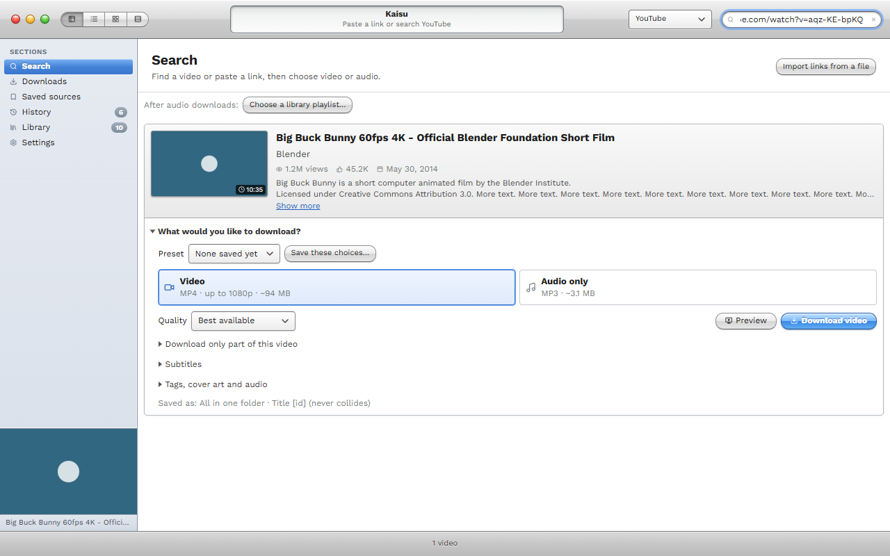
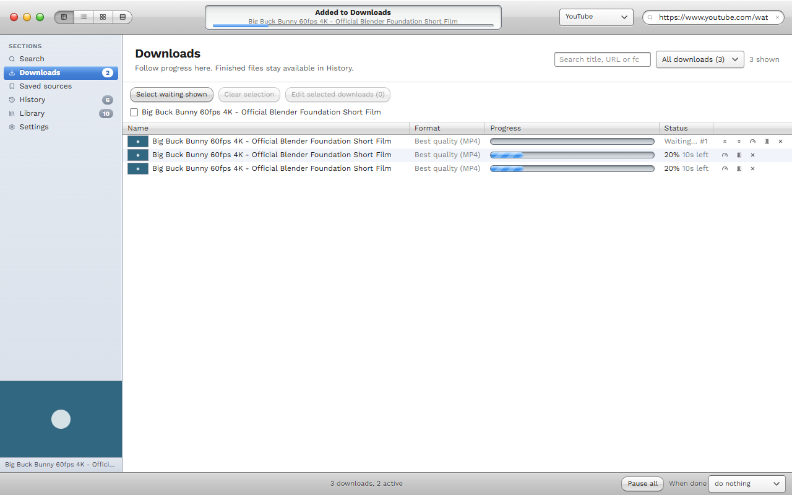
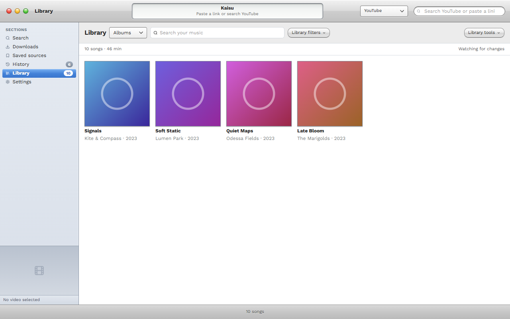
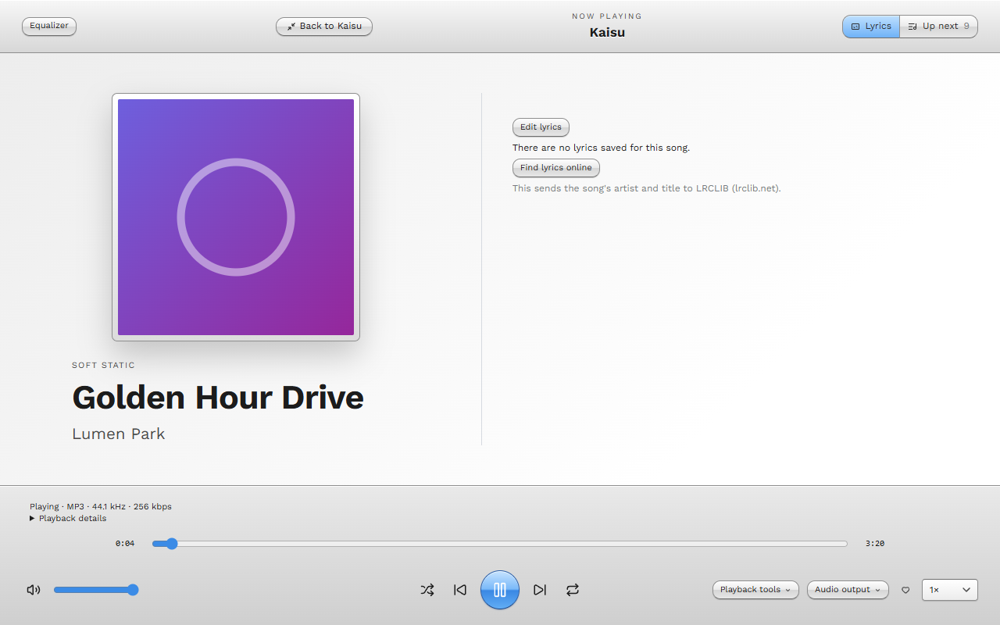
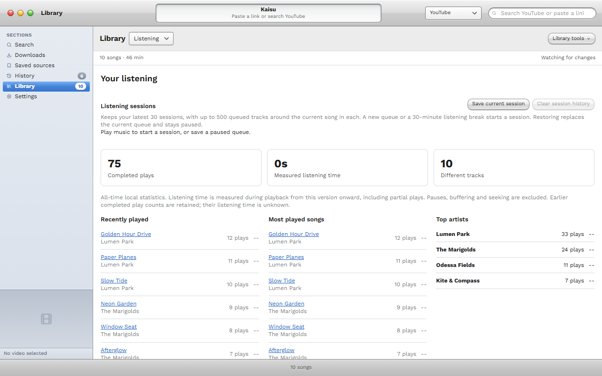
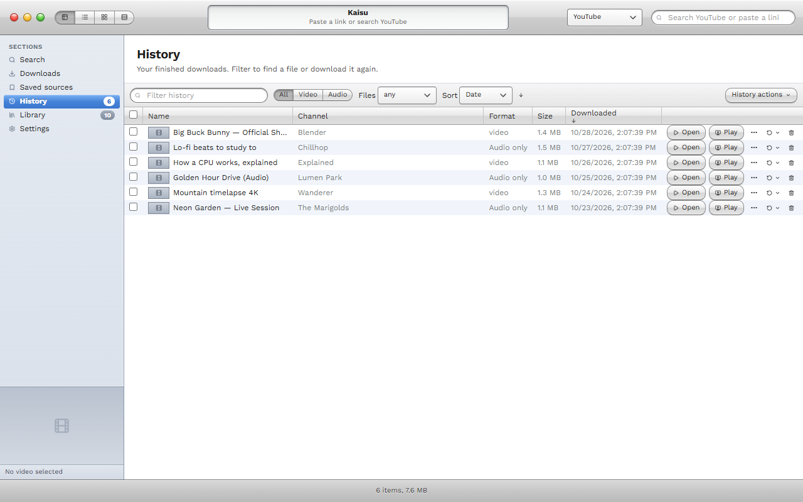
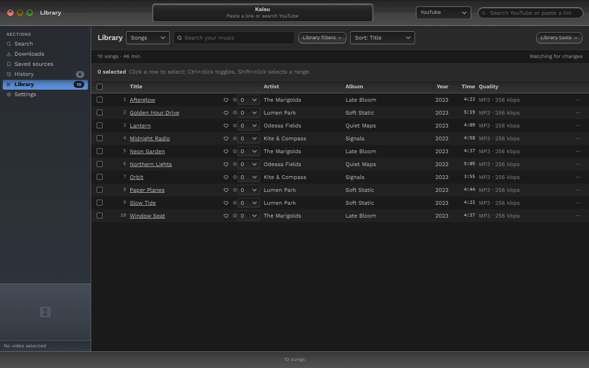
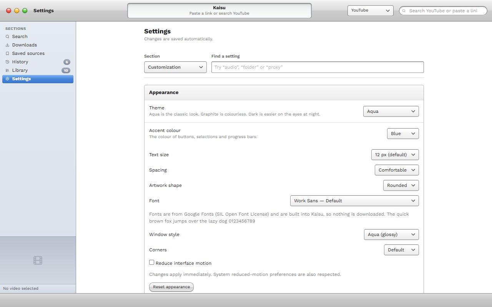

<h1 align="center">Kaisu</h1>

  <strong>Download videos and music from YouTube and hundreds of other sites, then enjoy them in a music player that's built right in.</strong>

  Windows · Linux · Free · Nothing to install

  <a href="https://github.com/mirimomekiku/kaisu/releases"><strong>Download the latest release</strong></a>

  

> Kaisu is in early development (version 0.0.x). Expect a few rough edges.

---

## Why Kaisu

- **Simple first.** Paste a link, choose video or audio, press download. Problems are explained in plain words.
- **More than a downloader.** Your music lands in a library with a full player, playlists, lyrics and tags.
- **Yours to shape.** Themes, fonts, window styles and layouts can all be changed to suit you.
- **Private.** No account, no ads, no tracking. Everything stays on your computer.

---

## Download anything

- **Search or paste.** Search YouTube, YouTube Music or SoundCloud from one box, or paste a link from almost any site. Playlists and
  channels work too, and you can paste or drop many links at once.
- **Your choice of quality.** Pick video or audio, choose a quality, and grab only the part of a video you want. Subtitles can be saved
  inside the video or beside it.
- **Preview first.** Watch the first 20 seconds in Kaisu before you commit to a download.
- **A queue you control.** Drag downloads to reorder them, pause and resume, or set a speed limit for one download. Unfinished downloads
  come back after a restart.
- **Saved sources.** Follow a channel or playlist and check it for new items whenever you like.
- **Retry in one click.** Failed downloads are grouped together with the likely reason, and a single button tries them again.
- **From your browser.** A small extension for Chrome, Edge and Firefox sends links to Kaisu. Nothing downloads until you say so.
- **Convert.** Turn any finished download into MP3, M4A, Opus, FLAC or WAV. The original is kept.

---

## A music library that feels at home

<table>
  <tr>
    <td width="50%"></td>
    <td width="50%"></td>
  </tr>
</table>

- **Browse your way.** View songs, albums, artists or playlists. Add music you already own without moving a single file.
- **Full-screen player.** Big artwork, synced lyrics and an Up next queue, with shuffle, repeat, playback speed and a sleep timer that
  fades out gently.
- **Smooth listening.** Crossfade between songs, a ten-band equalizer, A–B looping, and a mini-player that stays on top.
- **Playlists.** Organise them in folders, give them a cover, export them as `.m3u8`, or build smart playlists such as *Most played*,
  *Never played* or *Top rated* that update themselves.
- **Lyrics.** Read saved lyrics, find them online (only when you agree), or write and time your own.
- **Auto-tag.** Fix titles, artists, albums and cover art using MusicBrainz and the Cover Art Archive. You review every change first.
- **Library health.** Spot missing files, incomplete tags and exact duplicates, and clean them up safely.
- **Favorites and ratings.** Heart your best songs, rate them from 1 to 5, and filter by either.

**Your listening, at a glance.** See what you played recently, your most played songs, top artists and how much time you've spent
listening. Save a listening session and pick up where you left off.

---

## Stay organised

- **History** keeps every download with its size and channel. Sort, filter, reopen files, download again, or export the list.
- **Smart names and folders.** Save music as Artist / Album folders, tidy up "(Official Video)" from titles, and sort files by channel,
  year or type.
- **Move to an external drive.** Finished files move or copy over by themselves, and wait patiently if the drive isn't plugged in.
  Nothing is removed until the copy has been checked.
- **Clean up.** Remove old downloads after a number of days. They go to the Recycle Bin or Trash by default.
- **Friendly warnings.** Kaisu tells you before you download something you already have, or when the disk is nearly full.

---

## Make it yours

<table>
  <tr>
    <td width="50%"></td>
    <td width="50%"></td>
  </tr>
</table>

- **Themes.** Aqua, Graphite and Dark, or follow your system and switch automatically between light and dark. Build your own colour
  palette and share it as a file.
- **Window style.** Choose the glossy Aqua look or a flat one, with square or rounder corners.
- **Fonts.** Seven built-in fonts, including Lexend and Atkinson Hyperlegible Next for easier reading. They ship with the app, so
  nothing is downloaded.
- **Layout.** Resize text, switch between compact and comfortable spacing, reorder the sidebar and pin your favourite playlists.
- **Presets.** Save your whole setup and switch between looks in a click.
- **Command palette.** Press <kbd>Ctrl</kbd>+<kbd>K</kbd> (or <kbd>⌘</kbd>+<kbd>K</kbd>) and type to jump to any page or action.
  Press <kbd>F1</kbd> to see every keyboard shortcut.

---

## Simple or Advanced

| Simple mode | Advanced mode |
| --- | --- |
| Paste, choose video or audio, download. | Everything in Simple, plus: |
| Sensible defaults and plain-language errors. | Site rules ("anything from this site is audio, saved as FLAC in this folder"). |
| | Exact format choice, SponsorBlock, browser cookies and speed limits. |
| | Bandwidth schedules, download logs and your own yt-dlp options. |

Switch at any time in Settings.

---

## Getting started

1. Download the **kaisu** file for your system from the [Releases page](https://github.com/mirimomekiku/kaisu/releases) and run it.
2. On first launch Kaisu offers to fetch the helper tools it needs (about 100–200 MB). It takes one click, keeps everything in its own
   folder and changes nothing else on your computer.
3. A short tour shows you around. Then paste a link and go.

On Windows, Kaisu can update itself: it tells you when a new version is out, and **Install update** downloads it and checks its
signature. It only restarts when you say so.

**Prefer the terminal?** A text-based version is included. Run `tui/run-tui.cmd` (Windows) or `tui/run-tui.sh` (Linux).

---

## Good to know

- Search works with YouTube, YouTube Music and SoundCloud. Other sites work by pasting a link.
- Proxy passwords are kept in your system's password store (Windows Credential Manager, macOS Keychain or the Secret Service on Linux).
- Lyrics lookup and auto-tagging stay off until you agree, and send only the artist and title to the free LRCLIB and MusicBrainz services.
- Deleted files go to the Recycle Bin or Trash, where you can restore them.
- The Windows app is not code-signed yet, so Windows may warn you the first time you run it.
- Kaisu is for downloading content you have the right to save. You are responsible for following the terms of the sites you use and
  the laws where you live.

---

## For developers

Build and test instructions are in [CONTRIBUTING.md](CONTRIBUTING.md). Browser extension details are in
[`extension/README.md`](extension/README.md).

## Credits and licences

Kaisu is built on [yt-dlp](https://github.com/yt-dlp/yt-dlp) and ffmpeg.

The interface fonts (Work Sans, Inter, Source Sans 3, Lexend, Atkinson Hyperlegible Next, Lora, JetBrains Mono) are from Google Fonts
and licensed under the SIL Open Font License 1.1.

The ffmpeg that Kaisu downloads is the LGPL build, without GPL or non-free codecs. If you redistribute Kaisu, include the licence texts
for ffmpeg and yt-dlp.
